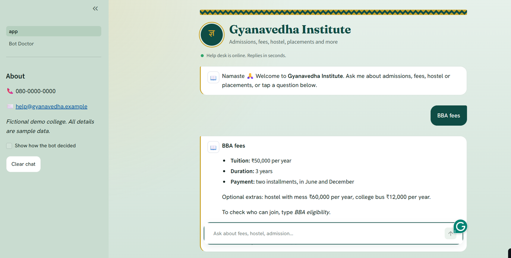

# Gyanavedha Institute: FAQ Chatbot with a Built-in "Bot Doctor"

A customer-support chatbot for a UG and PG college. It answers common questions about admissions, fees, courses, exams, hostel, scholarships, placements and more, and it tells the college office **how to make itself better**.

**Live demo:** https://gyanavedha-assistant.streamlit.app/

> Gyanavedha Institute is a **fictional demo college**. All fees, dates, phone numbers and e-mail addresses in this project are sample data.

<!-- Add a screenshot: save it as docs/screenshot.png and uncomment the next line -->
<!--  -->

---

## What makes it different

Most student chatbot projects stop at "type a question, get an answer". This one goes further:

| Feature | What it does |
|---|---|
| **Plug-and-play FAQ file** | All knowledge lives in one file, `data/faqs.json`. Anyone can create a bot for their own business by editing that file. No Python needed. |
| **Bot Doctor** | A second page that tests the bot on sentences it has never seen and reports its accuracy, which intents get mixed up, which are weak, and what customers asked that the bot could not answer. |
| **Multi-question messages** | "fees and hostel? is there an annual fest?" is split into separate questions. Each one is answered, and unknown ones are logged. |
| **Safe fallback** | When the bot is not confident, it says so instead of guessing. A confidence threshold decides. |
| **Unanswered-question log** | Every question the bot could not answer is saved, so the owner knows what to add next. |
| **Thumbs up / thumbs down** | Customers rate each answer. Unhelpful answers appear in the Bot Doctor. |
| **Typo-tolerant** | Character-level features help with spelling mistakes ("accomodation", "placments") and mixed-language words. |

---

## How it works

```
Customer message
      |
      v
 split into questions        (bot.py)
      |
      v
 clean the text              (preprocess.py: lowercase, remove punctuation,
      |                       tokenize, remove filler words, lemmatize)
      v
 TF-IDF features             (word 1-2 grams + character 2-5 grams)
      |
      v
 Logistic regression         (classifier.py: probability for every intent)
      |
      v
 confidence >= threshold?
   yes -> reply with that intent's answer
   no  -> safe fallback reply + log the question (logger.py)
```

Some design choices worth knowing:

- **Negations and question words are kept** during cleaning. "can't pay" must not become "pay", and "when" matters in "when are the exams".
- **Character n-grams** were added after testing showed that word features alone gave timid, low-confidence predictions on paraphrases and typos.
- **The threshold (0.35)** was picked by comparing in-scope and out-of-scope questions. At 0.35 it rejected all of my out-of-scope test sentences while answering 16 of 17 real ones.
- **The Bot Doctor uses cross-validation**: the bot is trained on part of the examples and tested on the rest, so the accuracy score reflects sentences it has not memorised.

---

## Project structure

```
gyanavedha-faq-chatbot/
├── app.py                  # Streamlit chat page
├── pages/
│   └── Bot_Doctor.py       # Bot Doctor page
├── chatbot/
│   ├── preprocess.py       # text cleaning with NLTK
│   ├── classifier.py       # TF-IDF + logistic regression, confidence threshold
│   ├── bot.py              # multi-question handling and replies
│   ├── logger.py           # unanswered-question and feedback logs (CSV)
│   └── doctor.py           # diagnosis engine for the Bot Doctor
├── data/
│   └── faqs.json           # the bot's knowledge: intents, examples, answers
├── tests/
│   └── test_bot.py         # 19 automated tests
├── .streamlit/config.toml  # theme colours
├── requirements.txt
└── requirements-dev.txt
```

---

## Run it on your computer

You need Python 3.10 or newer.

```bash
# 1. Get the code
git clone https://github.com/shravya-181/gyanavedha-faq-chatbot.git
cd gyanavedha-faq-chatbot

# 2. Create and activate a virtual environment (Windows)
python -m venv venv
venv\Scripts\activate
# macOS / Linux:  source venv/bin/activate

# 3. Install the packages
pip install -r requirements.txt

# 4. Start the app
streamlit run app.py
```

The first run downloads small NLTK word lists automatically. The app opens at `http://localhost:8501`, and the **Bot Doctor** page is in the sidebar.

### Run the tests

```bash
pip install -r requirements-dev.txt
python -m pytest -v
```

---

## Use it for your own business

1. Open `data/faqs.json`.
2. Change `business_name`, `fallback_reply` and the optional `tagline`, `suggestions` and `contact`.
3. Replace the `intents`. Each intent has:
   - `name`: a short label, for example `fee_structure`
   - `examples`: at least 8 different ways a customer might ask (variety matters more than quantity)
   - `answer`: the reply to give
4. Restart the app and open the **Bot Doctor**. It will tell you which intents need more examples.

---

## Tech stack

Python, Streamlit, scikit-learn (TF-IDF, logistic regression, cross-validation), NLTK (tokenizing, stop words, lemmatizing), pandas, pytest.

---

## Results

On the sample data, the Bot Doctor reports **__% accuracy on unseen sentences** (cross-validated). Starting from a lower score, it pointed to weak intents and overlapping ones. Adding varied examples to those intents raised the score.

*(Replace `__` with the number shown on your Bot Doctor page, and add your before and after if you have both.)*

---

## Limitations

- **Free hosting forgets the logs.** On Streamlit Community Cloud, the unanswered-question and feedback files are cleared when the app restarts. For permanent logs, a database would be the next step.
- **It only knows what the FAQ file teaches it.** It does not search the web or generate new answers, so it cannot answer questions outside its intents. That is deliberate, because it prevents confident wrong answers.
- **Small dataset.** A few examples per intent means accuracy depends heavily on how varied those examples are.
- **Some off-topic questions can still slip through** if they happen to resemble an intent.

---

## Roadmap

- Course-aware answers (different fees for BBA and MBA, remembering UG or PG)
- Hinglish support (for example "fees kitna hai")
- A human-handoff form that saves the customer's name and phone number
- An admin page to edit the FAQ file inside the app

---

## Author

**Shravya M S**
GitHub: [@shravya-181](https://github.com/shravya-181)

Built during the 2-Month Artificial Intelligence Internship at DEC Technologies.
